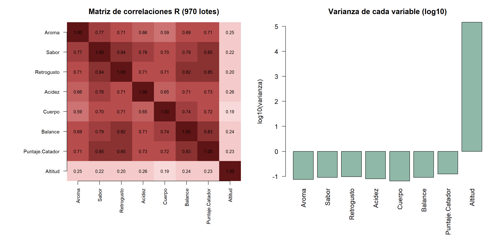
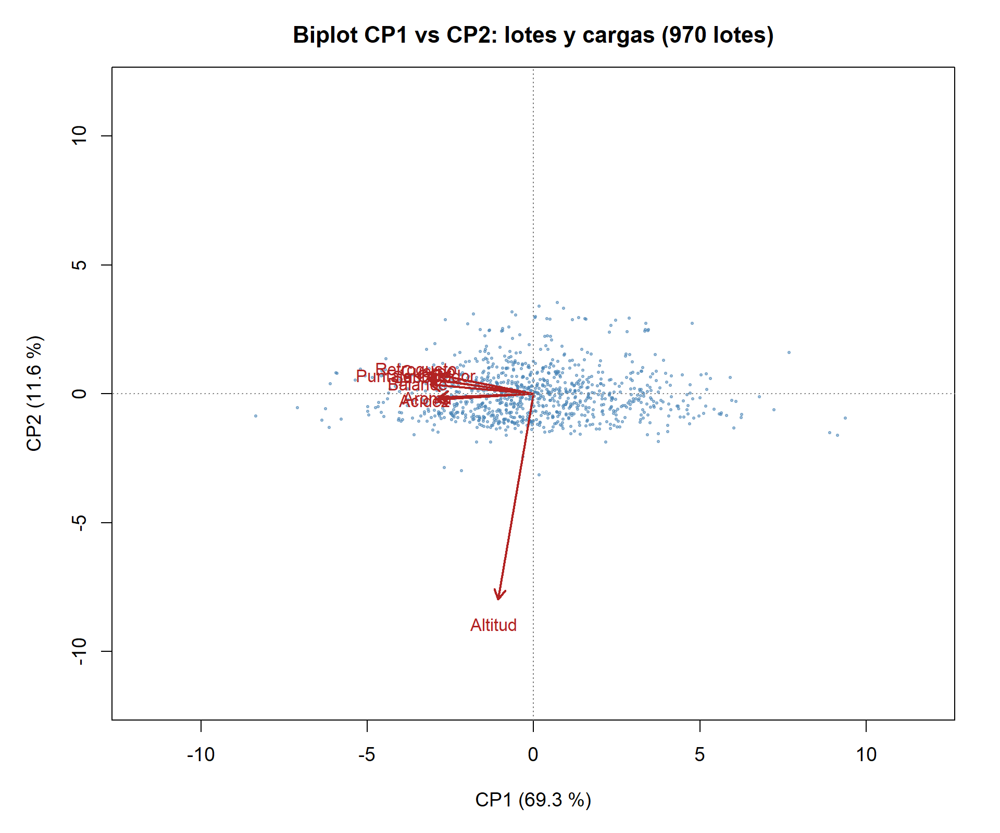
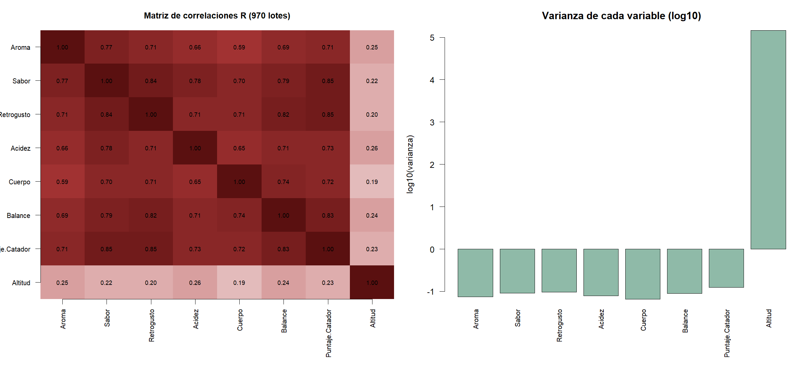

```{r setup, include=FALSE}
knitr::opts_chunk$set(echo = TRUE, warning = FALSE, message = FALSE, fig.align = "center")
dir.create("figuras/secuencia", showWarnings = FALSE, recursive = TRUE)
suppressMessages(library(knitr))
options(knitr.kable.NA = "—")
tabla <- function(x, ...) kable(x, format.args = list(decimal.mark = ",", big.mark = "."), row.names = FALSE, ...)
fm <- function(x, d = 0) format(round(x, d), nsmall = d, decimal.mark = ",", big.mark = ".")
```

::: {.resumen}
**En resumen.** Las figuras muestran, en orden, cómo se pasa de 1.070 a 970 lotes: PCA con los atípicos marcados, diagnósticos de la base (cajas ajustadas, ceros, asimetría, varianzas), distancias de Mahalanobis y la comprobación exploratoria de humedad = 0.
:::

# Qué responde este informe

**Pregunta:** ¿cómo se ve, paso a paso, la depuración de 1.070 a 970 lotes y qué muestran los diagnósticos descriptivos de la base?

Cada sección presenta: *qué se dibuja y por qué*, *la figura* y *cómo se lee*.

| Sección | Figuras | Mensaje principal |
|---|---|---|
| 1 | PCA con atípicos marcados; mapa de cargas | Los atípicos están en los extremos; CP1 = calidad |
| 2 | Cajas ajustadas, ceros y máximos, asimetría, covarianzas | La asimetría desaparece al retirar los atípicos |
| 3 | Mahalanobis, correlaciones, biplot | Dos caminos de cálculo dan los mismos atípicos |
| 4 | Varianzas y correlaciones de los 970 lotes | Los siete atributos están muy correlacionados |
| 5 | Humedad = 0 y sus vecinos | Comprobación exploratoria; la causa sigue sin confirmar |

> Este documento dibuja la secuencia de figuras de la cadena de depuración **1.070 → 970 lotes**. La cadena y las bases se construyen en [depuracion.Rmd](depuracion.Rmd) (`base_1070.rds`, `base_sin_atipicos.rds` y `datos_final_970.rds`); el PCA final se desarrolla en [pca_final.Rmd](pca_final.Rmd).

# 1. Secuencia de depuración: 1.070 → 970 lotes

El PCA preliminar se ajusta sobre los 1.070 lotes y se marcan como atípicos multivariados los que superan el cuantil 97,5 % de una χ² con 8 grados de libertad. La distancia se calcula dividiendo **cada columna** de scores entre su propia desviación estándar (`sweep(pre$x, 2, pre$sdev, "/")`), lo que equivale exactamente a la distancia de Mahalanobis de la matriz estandarizada. El filtro se aplica una sola vez.

La figura final de esta sección es el mapa de calor de las cargas de CP1–CP3 del PCA sobre los 970 lotes. Para la varianza explicada, los scores y el biplot del modelo definitivo se utiliza [PCA final](pca_final.Rmd).

Las figuras de esta sección se guardan en `figuras/secuencia/`.

**Qué se dibuja y por qué.** Primero, los lotes en el plano de las dos primeras componentes del PCA preliminar, con los atípicos en rojo: permite ver *dónde* están los lotes que se retiran. Después, el mapa de calor de las cargas del PCA final: permite ver cuánto pesa cada variable en cada componente.

```{r fig1}
# Figuras de la secuencia de depuración, en el orden en que se presentan:
# 1) PCA de 1.070 lotes con los atípicos marcados
# 2) Cargas CP1-CP3 del PCA final (970 lotes) como mapa de calor
suppressMessages(library(ggplot2))

th <- theme_minimal(base_size = 14) + theme(legend.position = "bottom")
lim <- qchisq(0.975, 8)

base <- readRDS("../datos/base_1070.rds")
T1070 <- base$trans
pre <- prcomp(T1070, center = TRUE, scale. = TRUE)

# Distancia correcta: cada columna de scores entre SU propia desviación
dm2 <- rowSums(sweep(pre$x, 2, pre$sdev, "/")^2)
out1 <- dm2 > lim
etq <- sprintf("Atípico (%d)", sum(out1))
p1 <- data.frame(CP1 = pre$x[, 1], CP2 = pre$x[, 2], Lote = ifelse(out1, etq, "Conservado"))
g1 <- ggplot(p1, aes(CP1, CP2, color = Lote)) + geom_point(alpha = 0.7, size = 1.6) +
  scale_color_manual(values = setNames(c("#1f4e79", "#c0392b"), c("Conservado", etq))) +
  labs(title = sprintf("PCA de 1.070 lotes: %d atípicos", sum(out1)),
       x = sprintf("CP1 (%.1f %%)", 100 * summary(pre)$importance[2, 1]),
       y = sprintf("CP2 (%.1f %%)", 100 * summary(pre)$importance[2, 2]), color = NULL) + th
ggsave("figuras/secuencia/seq1_pca1070_atipicos.png", g1, width = 8, height = 6, dpi = 200)

# PCA final oficial: 970 lotes (`datos_final_970.rds`).
fin <- readRDS("../datos/datos_final_970.rds")
F970 <- fin$datos_limpio
stopifnot(nrow(F970) == sum(!out1), identical(unname(fin$idx_atipicos), unname(which(out1))))
pf <- prcomp(F970, center = TRUE, scale. = TRUE)
L <- as.data.frame(as.table(pf$rotation[, 1:3]))
names(L) <- c("Variable", "Componente", "Carga")
L$Variable <- factor(L$Variable, levels = rev(rownames(pf$rotation)))
L$Componente <- factor(L$Componente, labels = c("CP1", "CP2", "CP3"))
g4 <- ggplot(L, aes(Componente, Variable, fill = Carga)) + geom_tile(color = "white") +
  geom_text(aes(label = sprintf("%.2f", Carga)), size = 5) +
  scale_fill_gradient2(low = "#2166ac", mid = "white", high = "#b2182b", limits = c(-1, 1)) +
  labs(title = "Cargas de CP1, CP2 y CP3 (970 lotes)", x = NULL, y = NULL) + theme_minimal(base_size = 14)
ggsave("figuras/secuencia/seq4_cargas_mapa.png", g4, width = 6.5, height = 6, dpi = 200)
g1
```

**Cómo se lee la primera figura.** Cada punto es un lote. Los `r sum(out1)` lotes rojos son los que superan el umbral de Mahalanobis; el núcleo azul (`r nrow(F970)` lotes) conserva la estructura principal de la nube.

```{r fig1b, fig.width=6.5, fig.height=6}
g4
```

**Cómo se lee el mapa de cargas.** Rojo es carga positiva y azul negativa; cuanto más intenso, más pesa la variable. **CP1** tiene los siete atributos sensoriales en el mismo tono (casi el mismo peso): resume la calidad general. **CP2** es casi solo la altitud. **CP3** contrasta aroma con cuerpo. (El signo global de cada columna es arbitrario.)

# 2. Diagnósticos descriptivos de la base y de la matriz final

Esta sección combina diagnósticos de la base inicial filtrada (14 variables, 1.070 lotes) con descriptivos de la matriz final de 970 lotes y 8 variables. Las salidas se guardan en `figuras/secuencia/` y no reemplazan las figuras de `imagenes_presentacion/`.

Las cajas ajustadas y la distribución de humedad parten de las 14 variables de la base inicial. El gráfico de asimetría compara las 8 variables del PCA en los 1.070 lotes con las mismas variables en los 970 lotes finales: tras retirar los atípicos multivariados ninguna supera |asimetría| > 1, de modo que el PCA final **no aplica Yeo-Johnson**. Las matrices de covarianzas y correlaciones se calculan sobre `datos_final_970.rds`.

```{r fig2}
library(dplyr)
library(robustbase)

out <- function(n) file.path("figuras/secuencia", n)

data <- read.csv("../data/arabica_data_cleaned.csv")
vars14 <- c("Aroma", "Flavor", "Aftertaste", "Acidity", "Body", "Balance",
            "Uniformity", "Clean.Cup", "Sweetness", "Cupper.Points",
            "Moisture", "Category.One.Defects", "Category.Two.Defects",
            "altitude_mean_meters")
data_f <- data %>%
  filter(is.na(altitude_mean_meters) | (altitude_mean_meters > 0 & altitude_mean_meters <= 3000)) %>%
  filter(!is.na(altitude_mean_meters))
datos14 <- data_f %>% select(all_of(vars14))

obj <- readRDS("../datos/datos_final_970.rds")
datos970 <- obj$datos_limpio
vars8 <- names(datos970)

# 1. Cajas ajustadas por medcouple (14 variables originales)
png(out("01_cajas_ajustadas_14.png"), width = as.integer(1800*1.6), height = as.integer(1200*1.6), res = 220)
par(mfrow = c(4, 4), mar = c(3, 3, 3, 1))
for (v in names(datos14)) {
  adjbox(datos14[[v]][!is.na(datos14[[v]])], main = v, col = "#f2d7a8", pch = 1, cex = 0.5)
}
plot.new()
text(0.5, 0.5, "Cajas ajustadas por medcouple\n(una escala por variable,\n1.070 lotes)", cex = 1.2)
dev.off()

# 2. Inflación de ceros y máximos
png(out("02_ceros_y_maximos.png"), width = as.integer(1500*1.6), height = as.integer(700*1.6), res = 220)
par(mfrow = c(1, 2), mar = c(4, 4, 3, 1))
hist(datos14$Moisture, breaks = 40, col = "#c9a27a", main = "Humedad: 174 lotes con valor 0",
     xlab = "Moisture (%)")
barplot(c(Sweetness = mean(datos14$Sweetness == 10), Uniformity = mean(datos14$Uniformity == 10),
          Clean.Cup = mean(datos14$Clean.Cup == 10)) * 100, col = "#8fb8a8", ylim = c(0, 100),
        ylab = "% de lotes con valor 10", main = "Inflación de máximos")
dev.off()

# 3. Asimetría de las 8 variables: 1.070 lotes frente a los 970 lotes finales (sin Yeo-Johnson)
skew <- function(x) mean((x - mean(x))^3) / sd(x)^3
sk_pre <- sapply(readRDS("../datos/base_1070.rds")$raw, skew)
sk_post <- sapply(datos970, skew)
cat("Variables con |asimetría| > 1: 1.070 lotes ->", sum(abs(sk_pre) > 1), "; 970 lotes ->", sum(abs(sk_post) > 1), "\n")
png(out("03_asimetria_1070_vs_970.png"), width = as.integer(1600*1.6), height = as.integer(800*1.6), res = 220)
par(mfrow = c(1, 2), mar = c(8, 4, 3, 1))
barplot(sk_pre, las = 2, col = ifelse(abs(sk_pre) > 1, "firebrick", "steelblue"),
        main = "Asimetría en 1.070 lotes", ylab = "Asimetría")
abline(h = c(-1, 1), lty = 2)
barplot(sk_post, las = 2, col = "steelblue", main = "Asimetría en 970 lotes (sin Yeo-Johnson)",
        ylab = "Asimetría")
abline(h = c(-1, 1), lty = 2)
dev.off()

# 4. Varianzas y covarianzas de la matriz final de 970 lotes
S <- cov(datos970)
png(out("04_varianzas_covarianzas.png"), width = as.integer(1500*1.6), height = as.integer(1000*1.6), res = 220)
par(mfrow = c(1, 2), mar = c(8, 8, 3, 1))
image(1:8, 1:8, t(S[8:1, ]), col = hcl.colors(30, "Blue-Red 3"), axes = FALSE,
      main = "Matriz de covarianzas S (970 lotes, 8 variables)", xlab = "", ylab = "")
axis(1, 1:8, colnames(S), las = 2); axis(2, 1:8, rev(colnames(S)), las = 2)
R <- cor(datos970)
image(1:8, 1:8, t(R[8:1, ]), col = hcl.colors(30, "Blue-Red 3"), axes = FALSE, zlim = c(-1, 1),
      main = "Matriz de correlaciones R", xlab = "", ylab = "")
axis(1, 1:8, colnames(R), las = 2); axis(2, 1:8, rev(colnames(R)), las = 2)
dev.off()

png(out("05_varianza_por_variable.png"), width = as.integer(1400*1.6), height = as.integer(800*1.6), res = 220)
par(mar = c(8, 5, 3, 1))
barplot(diag(S), las = 2, col = "#8fb8a8", log = "y",
        main = "Varianza de cada variable (escala log): la altitud domina",
        ylab = "Varianza (log)")
dev.off()

```

```{r fig2-cajas, fig.cap="Cajas ajustadas por medcouple para las 14 variables originales (1.070 lotes)."}
include_graphics(out("01_cajas_ajustadas_14.png"))
```

**Cajas ajustadas.** Cada variable se dibuja con su propia escala, usando la caja ajustada de Hubert y Vandervieren, que no castiga a las variables asimétricas. Sirve para ver qué variables tienen colas largas o valores extremos antes de decidir cómo tratarlas.

```{r fig2-ceros, fig.cap="Izquierda: humedad; derecha: porcentaje de lotes con puntaje 10."}
include_graphics(out("02_ceros_y_maximos.png"))
```

**Ceros y máximos.** Hay `r sum(datos14$Moisture == 0)` lotes con humedad igual a 0, un valor poco verosímil para café en grano; la fuente no explica la causa, así que se trata como anomalía observada. Además, `Sweetness`, `Uniformity` y `Clean.Cup` tienen una fracción alta de lotes en el máximo (10): `r fm(100 * mean(datos14$Sweetness == 10))` %, `r fm(100 * mean(datos14$Uniformity == 10))` % y `r fm(100 * mean(datos14$Clean.Cup == 10))` % respectivamente. Casi no varían y aportan poca información. Por eso estas seis variables (con los dos conteos de defectos) quedan fuera del PCA.

```{r fig2-asim, fig.cap="Asimetría de las 8 variables: izquierda, 1.070 lotes; derecha, 970 lotes finales. Rojo: |asimetría| > 1."}
include_graphics(out("03_asimetria_1070_vs_970.png"))
```

**Asimetría.** En los 1.070 lotes, `r sum(abs(sk_pre) > 1)` variables (rojo) superan |asimetría| 1: la cola larga de lotes muy bajos las vuelve muy asimétricas. En los 970 lotes finales la superan `r sum(abs(sk_post) > 1)`, de modo que no hace falta transformar.

```{r fig2-cov, fig.cap="Matriz de covarianzas (izquierda) y de correlaciones (derecha) de los 970 lotes."}
include_graphics(out("04_varianzas_covarianzas.png"))
```

```{r fig2-var, fig.cap="Varianza de cada variable, escala logarítmica."}
include_graphics(out("05_varianza_por_variable.png"))
```

**Covarianzas y varianzas.** La altitud tiene una varianza de `r fm(diag(S)["Altitud"])` (escala de metros al cuadrado), más de un millón de veces mayor que la de los puntajes (`r fm(min(diag(S)), 2)` a `r fm(max(diag(S)[1:7]), 2)`). Si no se estandarizara, el PCA se limitaría a reproducir la altitud. Por eso se estandariza antes.

# 3. Distancias de Mahalanobis en los 1.070 lotes

Diagnóstico sobre la base inicial transformada y estandarizada (`base_1070.rds`; ninguna variable de esta base requiere más que la transformación selectiva ya guardada). La distancia se calcula directamente con `mahalanobis()`, y debe coincidir con la de la sección 1: es la misma distancia calculada por dos caminos.

**Qué se dibuja y por qué.** El histograma de las distancias (en escala log) con el umbral en rojo, y el plano PC1–PC2 con los atípicos coloreados; después, las correlaciones con sus valores y un biplot de los 970 lotes. Sirve como comprobación independiente.

```{r fig2b}
Z1070 <- readRDS("../datos/base_1070.rds")$Z
dm2 <- mahalanobis(Z1070, colMeans(Z1070), cov(Z1070))
umbral <- qchisq(0.975, df = ncol(Z1070))
atip <- dm2 > umbral
cat("Atípicos:", sum(atip), " | coincide con la sección 1:", identical(unname(which(atip)), unname(fin$idx_atipicos)), "\n")
pca_p <- prcomp(Z1070, center = FALSE, scale. = FALSE)   # Z1070 ya está estandarizada
png(out("06_mahalanobis.png"), width = as.integer(1600*1.6), height = as.integer(800*1.6), res = 220)
par(mfrow = c(1, 2), mar = c(4, 4, 3, 1))
hist(log10(dm2), breaks = 60, col = "#c9d9e8", main = "Distancias de Mahalanobis (log10 d²M)",
     xlab = "log10(d²M)")
abline(v = log10(umbral), col = "firebrick", lwd = 2)
plot(pca_p$x[, 1], pca_p$x[, 2], pch = 19, cex = 0.5,
     col = ifelse(atip, "firebrick", adjustcolor("steelblue", 0.4)),
     xlab = "PC1", ylab = "PC2", main = "PC1 vs PC2: atípicos en rojo")
dev.off()

R <- cor(datos970)
S <- cov(datos970)
png("figuras/secuencia/04b_correlacion_y_varianza.png", width = as.integer(1800*1.6), height = as.integer(900*1.6), res = 220)
par(mfrow = c(1, 2), mar = c(9, 9, 3, 1))
image(1:8, 1:8, t(R[8:1, ]), col = hcl.colors(30, "Blue-Red 3"), zlim = c(-1, 1), axes = FALSE,
      main = "Matriz de correlaciones R (970 lotes)", xlab = "", ylab = "")
axis(1, 1:8, colnames(R), las = 2, cex.axis = 0.8)
axis(2, 1:8, rev(colnames(R)), las = 2, cex.axis = 0.8)
for (i in 1:8) for (j in 1:8) text(j, 9 - i, sprintf("%.2f", R[i, j]), cex = 0.7)
v <- diag(S)
par(mar = c(9, 5, 3, 1))
b <- barplot(log10(v), names.arg = names(v), las = 2, col = "#8fb8a8",
             main = "Varianza de cada variable (log10)", ylab = "log10(varianza)")
dev.off()

pca <- prcomp(datos970, center = TRUE, scale. = TRUE)
png("figuras/secuencia/07_biplot_limpio.png", width = as.integer(1200*1.6), height = as.integer(1000*1.6), res = 220)
par(mar = c(5, 5, 3, 2))
sc <- 0.85 * max(abs(pca$x[, 1:2])) / max(abs(pca$rotation[, 1:2]))
lim <- 1.25 * max(abs(c(pca$x[, 1:2], pca$rotation[, 1:2] * sc)))
plot(pca$x[, 1], pca$x[, 2], pch = 19, cex = 0.35, col = adjustcolor("steelblue", 0.45),
     xlim = c(-lim, lim), ylim = c(-lim, lim),
     xlab = paste0("CP1 (", round(summary(pca)$importance[2, 1] * 100, 1), " %)"),
     ylab = paste0("CP2 (", round(summary(pca)$importance[2, 2] * 100, 1), " %)"),
     main = "Biplot CP1 vs CP2: lotes y cargas (970 lotes)")
arrows(0, 0, pca$rotation[, 1] * sc, pca$rotation[, 2] * sc, length = 0.1, col = "firebrick", lwd = 2)
text(pca$rotation[, 1] * sc * 1.12, pca$rotation[, 2] * sc * 1.12, rownames(pca$rotation),
     col = "firebrick", cex = 0.9)
abline(h = 0, v = 0, lty = 3, col = "grey50")
dev.off()

```

```{r fig2b-maha, fig.cap="Izquierda: distancias de Mahalanobis (log). Derecha: PC1 vs PC2 con los atípicos en rojo."}
include_graphics(out("06_mahalanobis.png"))
```

**Cómo se lee.** Se marcan `r sum(atip)` lotes, y la comprobación de arriba indica que `r if (identical(unname(which(atip)), unname(fin$idx_atipicos))) 'son exactamente los mismos' else 'NO son los mismos'` que retira la cadena de [depuración](depuracion.html): el resultado no depende del camino de cálculo.

```{r fig2b-cor, fig.cap="Correlaciones de los 970 lotes (izquierda) y varianza de cada variable (derecha)."}

```

```{r fig2b-bip, fig.cap="Biplot CP1 vs CP2 de los 970 lotes: puntos = lotes, flechas = variables."}

```

**Correlaciones y biplot.** Los siete atributos sensoriales están fuertemente correlacionados entre sí, por eso apuntan en la misma dirección en el biplot y se resumen en una sola componente. La altitud casi no se correlaciona con ellos y forma su propio eje.

# 4. Matriz original: varianzas y correlaciones de los 970 lotes

Este bloque utiliza `datos_final_970.rds` y toma `datos_originales`: calcula covarianzas y correlaciones en la escala original de las ocho variables. Como el PCA final no aplica Yeo-Johnson, coincide con la matriz que alimenta el PCA antes de estandarizar. Es una descripción de la muestra final; no debe confundirse con las cargas ni con la varianza explicada del PCA.

```{r fig3}
obj <- readRDS("../datos/datos_final_970.rds")
R <- obj$datos_originales[, c("Aroma","Sabor","Retrogusto","Acidez","Cuerpo","Balance","Puntaje.Catador","Altitud")]
S <- cov(R); Rc <- cor(R)
cat("n =", nrow(R), " tr(S) =", format(round(sum(diag(S)), 0), big.mark = "."), " det(S) =", format(det(S), scientific = TRUE, digits = 3), "\n")
cat("varianza log10:", round(log10(diag(S)), 2), "\n")
cat("cor min/max off-diag:", round(min(Rc[upper.tri(Rc)]), 2), round(max(Rc[upper.tri(Rc)]), 2), "\n")
png("figuras/secuencia/varianzas_970.png", width = 2400, height = 1100, res = 150, bg = "transparent")
par(mfrow = c(1, 2), mar = c(7, 4, 3, 1))
image(1:8, 1:8, t(Rc[8:1, ]), col = colorRampPalette(c("white", "#b03a3a", "#5a1010"))(30), zlim = c(0, 1), axes = FALSE, xlab = "", ylab = "")
axis(1, 1:8, colnames(Rc), las = 2, cex.axis = 0.8); axis(2, 1:8, rev(rownames(Rc)), las = 2, cex.axis = 0.8)
for (i in 1:8) for (j in 1:8) text(i, 9 - j, sprintf("%.2f", Rc[j, i]), cex = 0.7)
title("Matriz de correlaciones R (970 lotes)", cex.main = 1)
bp <- barplot(log10(diag(S)), names.arg = colnames(S), las = 2, col = "#8fbaa8", ylab = "log10(varianza)", main = "Varianza de cada variable (log10)", cex.names = 0.8)
dev.off()

```

```{r fig3-mostrar, fig.cap="Correlaciones (izquierda) y varianza por variable (derecha), escala original de los 970 lotes."}

```

**Cómo se lee.** `tr(S)` es la varianza total (suma de varianzas) y `det(S)` la varianza generalizada. Las correlaciones entre los siete atributos sensoriales van de `r fm(min(Rc[1:7, 1:7][upper.tri(Rc[1:7, 1:7])]), 2)` a `r fm(max(Rc[1:7, 1:7][upper.tri(Rc[1:7, 1:7])]), 2)`: son variables muy redundantes, justo lo que el PCA aprovecha. Es una descripción de la muestra final y no debe confundirse con las cargas ni con la varianza explicada.

# 5. Humedad = 0 y vecindades: comprobación exploratoria

Este bloque compara la proporción de registros con `Moisture = 0` con la proporción observada entre sus 15 vecinos más cercanos en las matrices estandarizadas. La correspondencia entre las filas de `z0` (construida desde la base inicial de 1.070) y las filas de la base de 970 lotes se establece **explícitamente** con `idx_atipicos` de `datos_final_970.rds` (los 100 lotes retirados), y no depende de recalcular ningún umbral.

Observar humedad igual a cero no demuestra por sí solo que el valor sea faltante o inválido.

```{r fig4}
d <- read.csv("../data/arabica_data_cleaned.csv")
vars14 <- c("Aroma","Flavor","Aftertaste","Acidity","Body","Balance","Uniformity","Clean.Cup","Sweetness","Cupper.Points","Moisture","Category.One.Defects","Category.Two.Defects","altitude_mean_meters")
b <- d[!is.na(d$altitude_mean_meters) & d$altitude_mean_meters > 0 & d$altitude_mean_meters <= 3000, ]
b <- b[complete.cases(b[, vars14]), ]
z0 <- b$Moisture == 0
res_hum <- data.frame()
conservados <- setdiff(seq_len(nrow(b)), readRDS("../datos/datos_final_970.rds")$idx_atipicos)
stopifnot(nrow(readRDS("../datos/base_sin_atipicos.rds")$Z) == length(conservados))
for (base in c("../datos/base_1070.rds", "../datos/base_sin_atipicos.rds")) {
  X <- as.matrix(readRDS(base)$Z)
  idx <- if (base == "../datos/base_1070.rds") seq_len(nrow(b)) else conservados
  zz <- z0[idx]
  D <- as.matrix(dist(X))
  diag(D) <- Inf
  nb <- t(apply(D, 1, function(r) order(r)[1:15]))
  frac <- sapply(which(zz), function(i) mean(zz[nb[i, ]]))
  res_hum <- rbind(res_hum, data.frame(Base = if (base == "../datos/base_1070.rds") "1.070 lotes" else "970 lotes", `Lotes con humedad 0` = sum(zz), `% de la base` = round(mean(zz) * 100, 1), `% de vecinos con humedad 0` = round(mean(frac) * 100, 1), check.names = FALSE))
}
tabla(res_hum, align = "lrrr", caption = "Humedad = 0 y sus 15 vecinos más cercanos")
```

**Cómo se lee.** Si los ceros estuvieran repartidos al azar, entre los 15 vecinos de un lote con humedad 0 habría casi la misma proporción que en toda la base (columna «% de la base»). En los datos, entre los vecinos de un lote con humedad 0 la proporción es de `r fm(res_hum[1, 4], 1)` % (frente a `r fm(res_hum[1, 3], 1)` % en toda la base de 1.070) y de `r fm(res_hum[2, 4], 1)` % (frente a `r fm(res_hum[2, 3], 1)` %) en los 970 lotes. Es **apenas mayor**: los ceros se agrupan muy poco y están casi tan repartidos como si fueran al azar entre lotes parecidos. Eso no explica la causa: la fuente no dice que sean faltantes ni errores.

```{r fig4-fin, include=FALSE}

```
