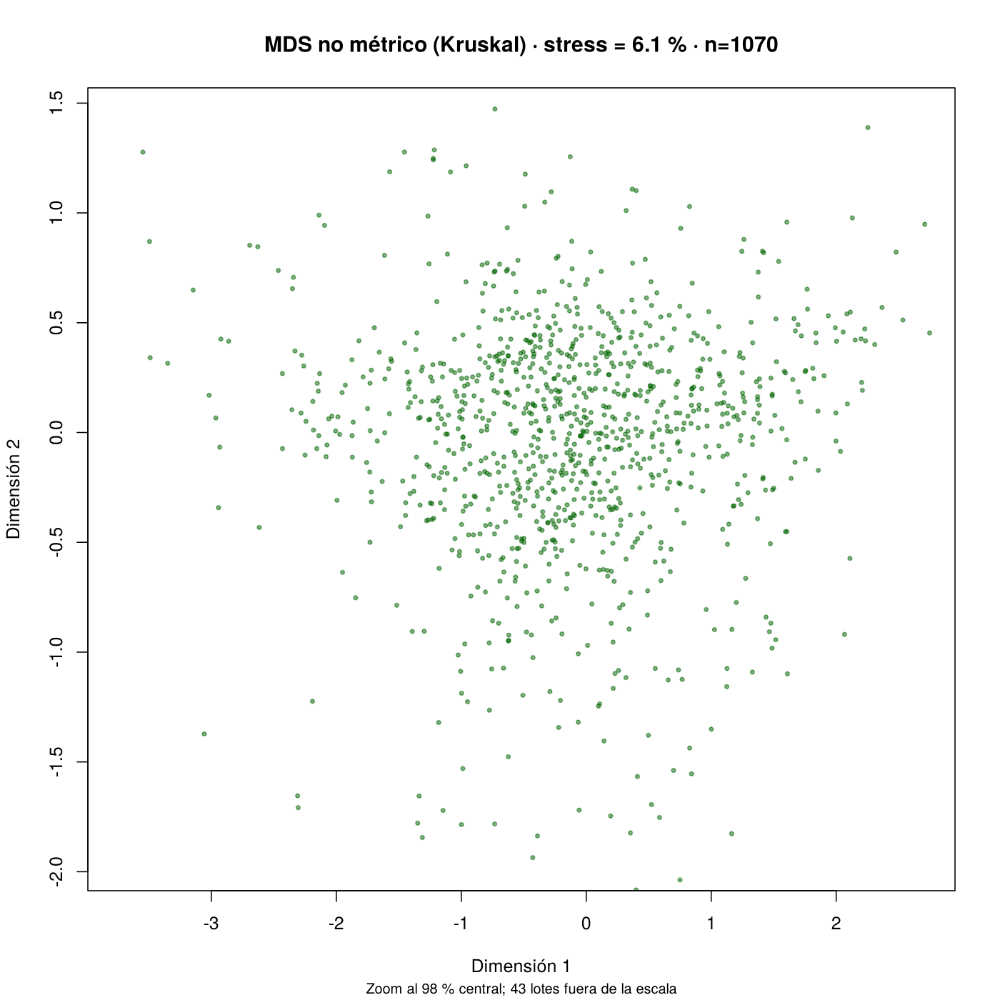

```{r setup, include=FALSE}
knitr::opts_chunk$set(echo = TRUE, warning = FALSE, message = FALSE, fig.align = "center")
for (d in c("figuras/exploratorios/kpca_1070","figuras/exploratorios/kpca_sin_atip","figuras/exploratorios/umap_tsne_1070","figuras/exploratorios/umap_tsne_sin_atip","figuras/exploratorios/mds_1070","figuras/exploratorios/mds_sin_atip","figuras/taller_970")) dir.create(d, recursive = TRUE, showWarnings = FALSE)
```

```{r helpers, include=FALSE}
suppressMessages(library(knitr))
options(knitr.kable.NA = "—")
fm <- function(x, d = 0) format(round(x, d), nsmall = d, decimal.mark = ",", big.mark = ".")
```

::: {.resumen}
**En resumen.** Se comparan cuatro familias de métodos de reducción de dimensionalidad: **Kernel PCA** (10 núcleos), **t-SNE**, **UMAP** y **MDS** (clásico y no métrico), sobre los 1.070 lotes y sobre los 970 lotes sin atípicos. Ninguno muestra grupos claramente separados: los lotes forman una nube continua, igual que en el PCA final. Son una mirada **exploratoria** complementaria; sus ejes no se interpretan y su forma depende de los parámetros.
:::

# Qué responde este informe

**Pregunta:** si en lugar del PCA lineal se usan métodos no lineales, ¿aparecen grupos que el PCA no ve?

Cada sección sigue el mismo esquema: *qué se hace y por qué*, *el resultado* y *cómo se lee*.

| Sección | Método | Para qué sirve | Mensaje principal |
|---|---|---|---|
| 1 | Kernel PCA (10 núcleos) | PCA en un espacio transformado por un núcleo | Solo el núcleo lineal reproduce el PCA; varios núcleos no son válidos |
| 2 | Métodos del taller (970 lotes) | PCA, Kernel PCA, t-SNE y UMAP en la matriz final | Una sola nube |
| 3 | UMAP y t-SNE | Conservar vecindades locales | La forma depende de los parámetros |
| 4 | MDS no métrico y Shepard | Conservar el orden de las distancias | El mapa comprime distancias |
| 5 | MDS con zoom | Ver el centro de la nube | Pocos lotes extremos dominan la escala |

> Métodos exploratorios. Ninguno de ellos define grupos. Las figuras se guardan en `figuras/exploratorios/`. El PCA oficial está en `pca_final.Rmd`.
>
> **Bases usadas.** `base_1070.rds` (1.070 lotes) y `base_sin_atipicos.rds` (970 lotes: se retiran 100 lotes con distancia de Mahalanobis > χ²(0,975; 8) calculada directamente sobre la matriz estandarizada). La sección 2 (métodos del taller) usa `datos_final_970.rds`, la matriz final que produce `depuracion.Rmd`; es la misma de `base_sin_atipicos.rds`, así que el Kernel PCA de 970 lotes de la sección 1 y el de la sección 2 son el mismo cálculo.

# 0. Funciones comunes

**Varianza explicada en Kernel PCA.** `kernlab::kpca()` guarda en `@eig` solo los primeros
`features` valores propios. Dividir entre la suma de esos valores da la proporción *dentro de las
primeras p componentes*, no la proporción de la inercia total del espacio de características. Para los
núcleos no lineales esa cifra sobreestima la varianza explicada. Aquí la proporción se calcula sobre
la traza de la matriz núcleo doblemente centrada (suma de todos los valores propios positivos), que es
la inercia total. Para el núcleo lineal (`vanilladot`) ambas cifras coinciden con el PCA clásico.

La columna `autovalores_neg` cuenta los valores propios negativos de la matriz núcleo centrada. Con
estos datos y parámetros aparecen en `tanhdot`, `besseldot` y `splinedot`: esas matrices no son
semidefinidas positivas, no definen un espacio euclídeo de características y sus porcentajes se
reportan solo como referencia. Note también que `rbfdot` con σ = 1 reparte la inercia en casi tantas
direcciones como lotes (las 8 primeras componentes no llegan al 16 %): con ese σ el núcleo es tan
local que no resume la estructura de los datos.

```{r funciones}
suppressMessages(library(kernlab))

configs <- list(
  list(name = "vanilladot", kernel = "vanilladot", kpar = list()),
  list(name = "rbfdot_sigma0.1", kernel = "rbfdot", kpar = list(sigma = 0.1)),
  list(name = "rbfdot_sigma1", kernel = "rbfdot", kpar = list(sigma = 1)),
  list(name = "polydot_grado2", kernel = "polydot", kpar = list(degree = 2, scale = 1, offset = 1)),
  list(name = "polydot_grado3", kernel = "polydot", kpar = list(degree = 3, scale = 1, offset = 1)),
  list(name = "tanhdot", kernel = "tanhdot", kpar = list(scale = 0.1, offset = 1)),
  list(name = "laplacedot_sigma0.1", kernel = "laplacedot", kpar = list(sigma = 0.1)),
  list(name = "besseldot", kernel = "besseldot", kpar = list(sigma = 1, order = 1, degree = 1)),
  list(name = "anovadot", kernel = "anovadot", kpar = list(sigma = 1, degree = 1)),
  list(name = "splinedot", kernel = "splinedot", kpar = list())
)

# Proporción de inercia de cada componente sobre la inercia total del núcleo centrado
varianza_kernel <- function(X, cfg, p) {
  kf <- do.call(cfg$kernel, cfg$kpar)
  K  <- kernelMatrix(kf, as.matrix(X))
  m  <- nrow(K)
  Kc <- K - rowMeans(K) - rep(colMeans(K), each = m) + mean(K)   # doble centrado
  ev <- eigen(Kc / m, symmetric = TRUE, only.values = TRUE)$values
  tol <- 1e-8 * max(abs(ev))
  total <- sum(ev[ev > tol])
  list(frac = ev[1:p] / total,
       acum = sum(ev[1:p]) / total,
       negativos = sum(ev < -tol))
}

# Tabla de varianza y figuras de pares para una matriz X
kpca_base <- function(X, carpeta_fig, p = ncol(X)) {
  tabla <- data.frame()
  for (cfg in configs) {
    kp <- tryCatch(kpca(~., data = as.data.frame(X), kernel = cfg$kernel, kpar = cfg$kpar, features = p),
                   error = function(e) { message("Falló ", cfg$name, ": ", conditionMessage(e)); NULL })
    if (is.null(kp)) next
    v <- varianza_kernel(X, cfg, p)
    fila <- data.frame(kernel = cfg$name, t(round(v$frac * 100, 1)),
                       acum_p = round(v$acum * 100, 1), autovalores_neg = v$negativos)
    names(fila)[2:(p + 1)] <- paste0("CP", 1:p)
    names(fila)[p + 2] <- paste0("acum_CP1_", p)
    tabla <- rbind(tabla, fila)
    png(sprintf("%s/pairs_%s.png", carpeta_fig, cfg$name), width = 1400, height = 1400, res = 150)
    pairs(rotated(kp)[, 1:4], pch = 19, cex = 0.4, col = adjustcolor("firebrick", 0.5), main = cfg$name)
    dev.off()
  }
  tabla
}
```

# 1. Kernel PCA: 10 núcleos sobre 1.070 lotes y sobre 970 lotes sin atípicos

```{r exp1}
set.seed(2026)
res_kp <- list()
for (base in c("../datos/base_1070.rds", "../datos/base_sin_atipicos.rds")) {
  tag <- if (base == "../datos/base_1070.rds") "1070" else "sin_atip"
  X <- readRDS(base)$Z
  tabla <- kpca_base(X, sprintf("figuras/exploratorios/kpca_%s", tag))
  res_kp[[tag]] <- tabla
  write.csv(tabla, sprintf("figuras/exploratorios/varianza_kpca_%s.csv", tag), row.names = FALSE)
  cat("== base", tag, "n =", nrow(X), "\n")
}
```

**Qué hacemos y por qué.** El Kernel PCA es un PCA que se calcula después de transformar los datos con un **núcleo** (una función de similitud), lo que permite capturar estructuras no lineales. Se prueban 10 núcleos. Un cuidado clave: el porcentaje de varianza explicada se calcula sobre la **inercia total** del espacio transformado (la traza de la matriz núcleo centrada), no solo sobre las primeras componentes.

```{r kp-1070}
knitr::kable(res_kp[["1070"]][, c("kernel", "CP1", "CP2", "CP3", "acum_CP1_8", "autovalores_neg")],
             col.names = c("Núcleo", "CP1 (%)", "CP2 (%)", "CP3 (%)", "Primeras 8 (%)", "Autovalores negativos"),
             format.args = list(decimal.mark = ","), caption = "Kernel PCA sobre 1.070 lotes")
```

```{r kp-970}
knitr::kable(res_kp[["sin_atip"]][, c("kernel", "CP1", "CP2", "CP3", "acum_CP1_8", "autovalores_neg")],
             col.names = c("Núcleo", "CP1 (%)", "CP2 (%)", "CP3 (%)", "Primeras 8 (%)", "Autovalores negativos"),
             format.args = list(decimal.mark = ","), caption = "Kernel PCA sobre 970 lotes sin atípicos")
```

```{r kp-texto, include=FALSE}
k9 <- res_kp[["sin_atip"]]
g <- function(nm, col) k9[k9$kernel == nm, col]
invalidos <- k9$kernel[k9$autovalores_neg > 0]
```

**Cómo se lee.**

- **Núcleo lineal (`vanilladot`)**: reproduce exactamente el PCA clásico (CP1 `r fm(g('vanilladot', 'CP1'), 1)` %, CP2 `r fm(g('vanilladot', 'CP2'), 1)`; las 8 componentes suman 100 %). Es la referencia.
- **Núcleo RBF**: con σ = 0,1 la inercia se reparte más (CP1 `r fm(g('rbfdot_sigma0.1', 'CP1'), 1)` %, 8 componentes `r fm(g('rbfdot_sigma0.1', 'acum_CP1_8'), 1)` %); con σ = 1 el núcleo es tan local que la inercia se dispersa en casi tantas direcciones como lotes (las 8 primeras suman solo `r fm(g('rbfdot_sigma1', 'acum_CP1_8'), 1)` %) y no resume la estructura.
- **Núcleos polinómicos**: concentran más en CP1 a mayor grado (`r fm(g('polydot_grado2', 'CP1'), 1)` % con grado 2 y `r fm(g('polydot_grado3', 'CP1'), 1)` % con grado 3).
- **Núcleos no válidos**: `r paste(invalidos, collapse = ', ')` tienen autovalores **negativos**: sus matrices no son semidefinidas positivas, no definen un espacio euclídeo y sus porcentajes se reportan solo como referencia (por ejemplo, el CP1 de `splinedot` no es una varianza real).

```{r kp-fig, out.width='48%', fig.show='hold', fig.cap='Kernel PCA sobre 970 lotes: componentes 1 a 4 de a pares. Izquierda: núcleo lineal (igual al PCA). Derecha: RBF con sigma = 0,1.'}
knitr::include_graphics(c('figuras/exploratorios/kpca_sin_atip/pairs_vanilladot.png', 'figuras/exploratorios/kpca_sin_atip/pairs_rbfdot_sigma0.1.png'))
```

**Cómo se lee la figura.** Cada celda enfrenta dos componentes. Con el núcleo lineal se ve una nube alargada y continua; con el RBF la nube se curva en forma de herradura (un efecto típico de este núcleo), pero sigue siendo continua: no aparecen grupos separados.

# 2. Métodos del taller sobre 970 lotes

PCA, Kernel PCA, t-SNE y UMAP del taller sobre la matriz final de 970 lotes (sin Yeo-Johnson: ninguna variable supera |asimetría| > 1).

La varianza total y la generalizada se reportan sobre la matriz **estandarizada** (es decir, sobre la
matriz de correlaciones R). Sobre la matriz sin estandarizar las cifras no son interpretables: la altitud está en metros y
los puntajes en una escala de 0 a 10, así que la traza y el determinante de S quedan dominados por las
unidades de cada variable.

```{r exp4}
library(Rtsne)
library(uwot)

set.seed(2026)
obj <- readRDS("../datos/datos_final_970.rds")
datos <- obj$datos_limpio
X <- scale(datos)
p <- ncol(datos)

res <- list()

R <- cor(datos)
res$varianza_total <- sum(diag(R))                 # = p en datos estandarizados
res$varianza_generalizada <- det(R)                # entre 0 (colinealidad) y 1 (independencia)
res$varianza_total_media <- res$varianza_total / p
res$varianza_generalizada_media <- res$varianza_generalizada^(1 / p)
res$R <- R
res$S_original <- cov(datos)                        # covarianza en escala original; solo como referencia

pca <- prcomp(datos, center = TRUE, scale. = TRUE)
res$pca_var <- summary(pca)$importance[2, ] * 100
res$pca_rot <- pca$rotation
res$pca_scores <- pca$x

png("figuras/taller_970/pca_pairs.png", width = as.integer(1400*1.6), height = as.integer(1400*1.6), res = 220)
pairs(pca$x[, 1:4], pch = 19, cex = 0.4, col = adjustcolor("steelblue", 0.5))
dev.off()
png("figuras/taller_970/pca_biplot.png", width = as.integer(1200*1.6), height = as.integer(1000*1.6), res = 220)
biplot(pca, scale = 0, cex = 0.5)
dev.off()
png("figuras/taller_970/pca_codo.png", width = as.integer(1000*1.6), height = as.integer(700*1.6), res = 220)
screeplot(pca, main = "Gráfico de codo — PCA 970 lotes")
dev.off()

cfg_rbf01 <- list(kernel = "rbfdot", kpar = list(sigma = 0.1))
cfg_rbf1  <- list(kernel = "rbfdot", kpar = list(sigma = 1))
cfg_poly  <- list(kernel = "polydot", kpar = list(degree = 2, scale = 1, offset = 1))
kp_rbf <- kpca(~., data = as.data.frame(X), kernel = "rbfdot", kpar = cfg_rbf01$kpar, features = 5)
kp_rbf_sigma_alto <- kpca(~., data = as.data.frame(X), kernel = "rbfdot", kpar = cfg_rbf1$kpar, features = 5)
res$kpca_rbf_var        <- round(varianza_kernel(X, cfg_rbf01, 5)$frac, 3)
res$kpca_rbf_sigma1_var <- round(varianza_kernel(X, cfg_rbf1, 5)$frac, 3)
res$kpca_poly_var       <- round(varianza_kernel(X, cfg_poly, 5)$frac, 3)

png("figuras/taller_970/kpca_rbf_pairs.png", width = as.integer(1400*1.6), height = as.integer(1400*1.6), res = 220)
pairs(rotated(kp_rbf)[, 1:4], pch = 19, cex = 0.4, col = adjustcolor("firebrick", 0.5))
dev.off()
png("figuras/taller_970/kpca_rbf_sigma1_pairs.png", width = as.integer(1400*1.6), height = as.integer(1400*1.6), res = 220)
pairs(rotated(kp_rbf_sigma_alto)[, 1:4], pch = 19, cex = 0.4, col = adjustcolor("firebrick", 0.5))
dev.off()

# Misma configuración que la sección 3 (pca = FALSE) para que los mapas sean comparables
set.seed(2026)
tsne30 <- Rtsne(X, dims = 2, perplexity = 30, theta = 0.5, pca = FALSE, check_duplicates = FALSE)
set.seed(2026)
tsne5 <- Rtsne(X, dims = 2, perplexity = 5, theta = 0.5, pca = FALSE, check_duplicates = FALSE)
png("figuras/taller_970/tsne_perp30.png", width = as.integer(1000*1.6), height = as.integer(1000*1.6), res = 220)
plot(tsne30$Y, pch = 19, cex = 0.5, col = adjustcolor("darkgreen", 0.5),
     xlab = "t-SNE 1", ylab = "t-SNE 2", main = "t-SNE (perplejidad = 30)")
dev.off()
png("figuras/taller_970/tsne_perp5.png", width = as.integer(1000*1.6), height = as.integer(1000*1.6), res = 220)
plot(tsne5$Y, pch = 19, cex = 0.5, col = adjustcolor("darkgreen", 0.5),
     xlab = "t-SNE 1", ylab = "t-SNE 2", main = "t-SNE (perplejidad = 5)")
dev.off()

set.seed(2026)
um15 <- umap(X, n_neighbors = 15)
set.seed(2026)
um5 <- umap(X, n_neighbors = 5)
png("figuras/taller_970/umap_vecinos15.png", width = as.integer(1000*1.6), height = as.integer(1000*1.6), res = 220)
plot(um15[, 1], um15[, 2], pch = 19, cex = 0.5, col = adjustcolor("purple", 0.5),
     xlab = "UMAP1", ylab = "UMAP2", main = "UMAP (vecinos = 15)")
dev.off()
png("figuras/taller_970/umap_vecinos5.png", width = as.integer(1000*1.6), height = as.integer(1000*1.6), res = 220)
plot(um5[, 1], um5[, 2], pch = 19, cex = 0.5, col = adjustcolor("purple", 0.5),
     xlab = "UMAP1", ylab = "UMAP2", main = "UMAP (vecinos = 5)")
dev.off()

saveRDS(res, "../datos/resultados_taller_970.rds")
cat("Varianza total (traza de R):", round(res$varianza_total, 3), "\n")
cat("Varianza generalizada (det R):", signif(res$varianza_generalizada, 3), "\n")
cat("PCA % varianza:", round(res$pca_var[1:4], 1), "\n")
cat("Kernel RBF sigma=0.1 (fracción de la inercia total):", res$kpca_rbf_var, "\n")
cat("Kernel RBF sigma=1 (fracción de la inercia total):", res$kpca_rbf_sigma1_var, "\n")
cat("Kernel polinomial grado 2 (fracción de la inercia total):", res$kpca_poly_var, "\n")
```

**Qué hacemos y por qué.** Se repite el análisis del taller sobre la matriz final de 970 lotes: PCA, Kernel PCA (RBF con dos valores de σ), t-SNE (perplejidad 30 y 5) y UMAP (15 y 5 vecinos). Se usan varias configuraciones para ver cuánto depende el resultado de los parámetros.

**Cómo se lee los números.** La traza de la matriz de correlaciones es `r fm(res$varianza_total, 0)` (una unidad por variable) y su determinante `r format(res$varianza_generalizada, digits = 2, scientific = FALSE, decimal.mark = ",")`, un valor muy pequeño que indica **alta redundancia** entre variables. El PCA explica `r fm(res$pca_var[1], 1)` %, `r fm(res$pca_var[2], 1)` %, `r fm(res$pca_var[3], 1)` % y `r fm(res$pca_var[4], 1)` % en sus cuatro primeras componentes.

```{r taller-pca, out.width='48%', fig.show='hold', fig.cap='PCA de 970 lotes. Izquierda: gráfico del codo. Derecha: biplot.'}
knitr::include_graphics(c('figuras/taller_970/pca_codo.png', 'figuras/taller_970/pca_biplot.png'))
```

**Cómo se lee.** El codo cae después de la segunda componente (la mayor parte de la variación está en CP1 y CP2). En el biplot, las flechas de los siete atributos sensoriales apuntan en la misma dirección y la de la altitud es casi perpendicular.

```{r taller-nl, out.width='48%', fig.show='hold', fig.cap='Izquierda: t-SNE con perplejidad 30. Derecha: UMAP con 15 vecinos (970 lotes).'}
knitr::include_graphics(c('figuras/taller_970/tsne_perp30.png', 'figuras/taller_970/umap_vecinos15.png'))
```

```{r taller-nl2, out.width='48%', fig.show='hold', fig.cap='Izquierda: t-SNE con perplejidad 5. Derecha: UMAP con 5 vecinos (970 lotes).'}
knitr::include_graphics(c('figuras/taller_970/tsne_perp5.png', 'figuras/taller_970/umap_vecinos5.png'))
```

**Cómo se lee.** Con parámetros más locales (perplejidad 5, 5 vecinos) aparecen pequeñas islas y filamentos; con parámetros más globales (30 y 15) la nube se une. Eso muestra que **la forma depende de los parámetros**: las islas no deben leerse como grupos reales. En t-SNE y UMAP las distancias entre islas y los ejes no tienen significado.

# 3. UMAP y t-SNE sobre 1.070 lotes y 970 lotes sin atípicos

UMAP con 15 y 5 vecinos; t-SNE con perplejidad 30 y 5.

```{r exp5}
for (base in c("../datos/base_1070.rds", "../datos/base_sin_atipicos.rds")) {
  tag <- if (base == "../datos/base_1070.rds") "1070" else "sin_atip"
  X <- as.matrix(readRDS(base)$Z)
  n <- nrow(X)

  for (nn in c(15, 5)) {
    set.seed(2026)
    U <- umap(X, n_neighbors = nn, n_components = 2, min_dist = 0.1)
    png(sprintf("figuras/exploratorios/umap_tsne_%s/umap_vecinos%d.png", tag, nn), width = 1400, height = 1400, res = 150)
    plot(U, pch = 19, cex = 0.5, col = adjustcolor("purple", 0.5), main = sprintf("UMAP (vecinos = %d) · %s · n=%d", nn, tag, n), xlab = "UMAP1", ylab = "UMAP2")
    dev.off()
  }
  for (pp in c(30, 5)) {
    set.seed(2026)
    T <- Rtsne(X, perplexity = pp, check_duplicates = FALSE, pca = FALSE, verbose = FALSE)$Y
    png(sprintf("figuras/exploratorios/umap_tsne_%s/tsne_perp%d.png", tag, pp), width = 1400, height = 1400, res = 150)
    plot(T, pch = 19, cex = 0.5, col = adjustcolor("forestgreen", 0.5), main = sprintf("t-SNE (perplejidad = %d) · %s · n=%d", pp, tag, n), xlab = "t-SNE 1", ylab = "t-SNE 2")
    dev.off()
  }
  cat("base", tag, "listo, n =", n, "\n")
}
```

**Qué hacemos y por qué.** Se repite UMAP y t-SNE con las dos bases (1.070 y 970 lotes) para ver si retirar los 100 atípicos cambia la estructura. Es una comprobación de **robustez**.

```{r ut-fig, out.width='48%', fig.show='hold', fig.cap='UMAP con 15 vecinos. Izquierda: 1.070 lotes. Derecha: 970 lotes sin atípicos.'}
knitr::include_graphics(c('figuras/exploratorios/umap_tsne_1070/umap_vecinos15.png', 'figuras/exploratorios/umap_tsne_sin_atip/umap_vecinos15.png'))
```

```{r ut-fig2, out.width='48%', fig.show='hold', fig.cap='t-SNE con perplejidad 30. Izquierda: 1.070 lotes. Derecha: 970 lotes sin atípicos.'}
knitr::include_graphics(c('figuras/exploratorios/umap_tsne_1070/tsne_perp30.png', 'figuras/exploratorios/umap_tsne_sin_atip/tsne_perp30.png'))
```

**Cómo se lee.** Las dos bases dan formas parecidas: una nube continua. Con los 1.070 lotes aparecen algunos puntos y pequeños grupos de lotes aislados en el borde, que corresponden a lotes inusuales. La conclusión no cambia con ninguna de las dos bases: **no hay grupos naturales claros**.

# 4. MDS: no métrico y diagrama de Shepard

Escalamiento multidimensional sobre 1.070 lotes y sobre 970 lotes sin atípicos.

```{r exp6}
suppressMessages(library(MASS))
mds_res <- data.frame()
for (base in c("../datos/base_1070.rds", "../datos/base_sin_atipicos.rds")) {
  tag <- if (base == "../datos/base_1070.rds") "1070" else "sin_atip"
  X <- as.matrix(readRDS(base)$Z); n <- nrow(X)

  D <- dist(X)
  set.seed(2026)
  nm <- isoMDS(D, k = 2, trace = FALSE)
  cl <- cmdscale(D, k = 2)
  dcl <- as.vector(dist(cl)); dor <- as.vector(D)
  stress_nm <- nm$stress
  png(sprintf("figuras/exploratorios/mds_%s/mds_no_metrico.png", tag), width = 1400, height = 1400, res = 150)
  plot(nm$points, pch = 19, cex = 0.5, col = adjustcolor("darkgreen", 0.5), main = sprintf("MDS no métrico (Kruskal) · stress = %.1f %% · n=%d", stress_nm, n), xlab = "Dimensión 1", ylab = "Dimensión 2")
  dev.off()
  png(sprintf("figuras/exploratorios/mds_%s/shepard_clasico.png", tag), width = 1400, height = 1400, res = 150)
  plot(dor, dcl, pch = 19, cex = 0.3, col = adjustcolor("steelblue", 0.2), main = sprintf("Diagrama de Shepard · MDS clásico · n=%d", n), xlab = "Distancia original", ylab = "Distancia en el mapa 2D")
  abline(0, 1, col = "red", lty = 2)
  dev.off()
  cat(tag, "n=", n, " stress no métrico (%) =", round(stress_nm, 1), " corr(original, 2D clásico) =", round(cor(dor, dcl), 3), "\n")
  mds_res <- rbind(mds_res, data.frame(Base = if (tag == "1070") "1.070 lotes" else "970 lotes", Lotes = n, `Stress no métrico (%)` = round(stress_nm, 1), `Correlación distancias originales y mapa 2D` = round(cor(dor, dcl), 3), check.names = FALSE))
}
knitr::kable(mds_res, format.args = list(decimal.mark = ","), caption = "Calidad de los mapas MDS")
```

**Qué hacemos y por qué.** El MDS dibuja los lotes en el plano para que las distancias del mapa se parezcan a las originales. El **MDS no métrico** conserva solo el *orden* de las distancias; su calidad se mide con el **stress** (menor es mejor; según Kruskal, menos de 5 % es excelente, 5–10 % bueno y 10–20 % aceptable). El **diagrama de Shepard** compara las distancias originales con las del mapa.

```{r mds-fig, out.width='48%', fig.show='hold', fig.cap='MDS sobre 1.070 lotes. Izquierda: MDS no métrico. Derecha: diagrama de Shepard del MDS clásico.'}
knitr::include_graphics(c('figuras/exploratorios/mds_1070/mds_no_metrico.png', 'figuras/exploratorios/mds_1070/shepard_clasico.png'))
```

**Cómo se lee.** El stress de `r fm(mds_res[[3]][1], 1)` % (1.070 lotes) y `r fm(mds_res[[3]][2], 1)` % (970 lotes) se considera `r if (max(mds_res[[3]]) < 5) 'excelente' else if (max(mds_res[[3]]) < 10) 'bueno' else if (max(mds_res[[3]]) < 20) 'aceptable' else 'pobre'`. En el diagrama de Shepard los puntos quedan **por debajo de la diagonal roja**: el mapa de 2 dimensiones comprime las distancias porque descarta las demás dimensiones; la correlación con las distancias originales es `r fm(mds_res[[4]][1], 2)` (1.070) y `r fm(mds_res[[4]][2], 2)` (970).

# 5. MDS no métrico con zoom al 98 % central

Versión con zoom de la configuración de MDS sobre 1.070 lotes.

```{r exp7}
X <- as.matrix(readRDS("../datos/base_1070.rds")$Z)
set.seed(2026)
nm <- isoMDS(dist(X), k = 2, trace = FALSE)
p <- nm$points
lx <- quantile(p[, 1], c(0.01, 0.99)); ly <- quantile(p[, 2], c(0.01, 0.99))
out <- sum(p[, 1] < lx[1] | p[, 1] > lx[2] | p[, 2] < ly[1] | p[, 2] > ly[2])
# Margen del 5 % del rango a cada lado (multiplicar los cuantiles por 1,1 solo funciona si el rango cruza el cero)
ex <- function(r) r + c(-1, 1) * 0.05 * diff(r)
png("figuras/exploratorios/mds_zoom_1070.png", width = 1400, height = 1400, res = 150)
plot(p, pch = 19, cex = 0.5, col = adjustcolor("darkgreen", 0.5), xlim = ex(lx), ylim = ex(ly),
     main = sprintf("MDS no métrico (Kruskal) · stress = %.1f %% · n=1070", nm$stress), xlab = "Dimensión 1", ylab = "Dimensión 2")
mtext(sprintf("Zoom al 98 %% central; %d lotes fuera de la escala", out), side = 1, line = 4, cex = 0.8)
dev.off()
cat("stress", round(nm$stress, 1), " fuera:", out, "\n")
```

**Qué hacemos y por qué.** En el MDS no métrico de 1.070 lotes unos pocos puntos extremos estiran la escala y comprimen el resto. Aquí se hace zoom al 98 % central para ver la forma de la nube.

```{r zoom-fig, fig.cap='MDS no métrico con zoom al 98 % central (1.070 lotes).'}

```

**Cómo se lee.** Quedan fuera de la escala `r out` lotes (el 2 % de los puntos más extremos). En el centro, la nube es continua y sin grupos separados.

# Conclusiones

1. **Kernel PCA:** solo el núcleo lineal reproduce el PCA; los núcleos `tanhdot`, `besseldot` y `splinedot` no son válidos (autovalores negativos) y el RBF con σ = 1 es demasiado local.
2. **t-SNE y UMAP:** la forma depende de los parámetros; con valores locales aparecen islas que no son grupos reales.
3. **MDS:** el mapa es una representación aproximada (las distancias se comprimen al pasar a 2 dimensiones) y no muestra grupos.
4. **En conjunto:** ningún método no lineal encuentra grupos que el PCA no vea. Los datos forman un continuo y el PCA final de 970 lotes es la referencia.
