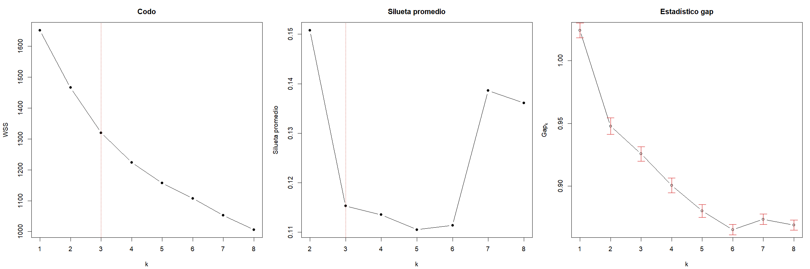
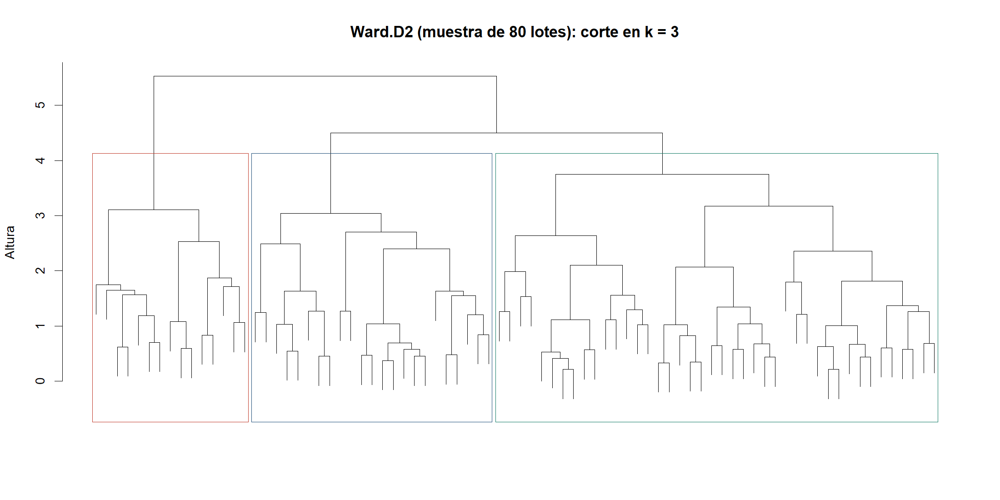
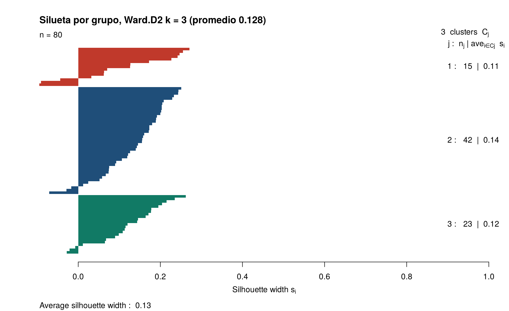

```{r setup, include=FALSE}
knitr::opts_chunk$set(echo = FALSE, warning = FALSE, message = FALSE, fig.align = "center")
suppressMessages(library(knitr))
tabla <- function(x, ...) kable(x, format.args = list(decimal.mark = ",", big.mark = "."), row.names = FALSE, ...)
fm <- function(x, d = 0) format(round(x, d), nsmall = d, decimal.mark = ",", big.mark = ".")

# Resultados guardados por revision_clustering_profesor.R (este documento NO vuelve a ejecutar el script)
tk <- read.csv("figuras/revision_profesor/tendencia_agrupamiento.csv")
txt <- readLines("resultados_clustering_profesor.txt", encoding = "UTF-8", warn = FALSE)
lin <- function(patron) txt[grep(patron, txt)[1]]
num <- function(s) as.numeric(regmatches(s, gregexpr("[0-9]+\\.?[0-9]*(e-?[0-9]+)?", s))[[1]])

k_sil <- tk$k[which.max(tk$silueta)]
l_km <- lin("^K-means k = 3")
sil_km <- num(sub(".*silueta promedio ([0-9.]+).*", "\\1", l_km))
neg_km <- num(sub(".*silueta negativa ([0-9]+) .*", "\\1", l_km))
l_w <- lin("^Tamaños: ")
sil_w <- num(sub(".*silueta promedio ([0-9.]+).*", "\\1", l_w))
l_h <- lin("^Alturas de las últimas")
alturas <- num(sub(".*: ([0-9., ]+);.*", "\\1", l_h))
l_ari <- lin("^ARI K-means")
ari <- num(sub(".*: ([0-9.]+)$", "\\1", l_ari))
l_chi <- lin("^Chi-cuadrado")
chi <- num(sub("Chi-cuadrado = ([0-9.]+),.*", "\\1", l_chi))
l_prop <- lin("^Proporciones")
```

::: {.resumen}
**En resumen.** Siguiendo las recomendaciones del profesor, se evalúa si los datos **tienen tendencia al agrupamiento** (codo, silueta promedio y estadístico gap), se revisa cuántos grupos admite el dendrograma de Ward, se mide la silueta por grupo y se compara una variable que **no** entra al agrupamiento (humedad igual a 0) entre los grupos de K-means. Resultado: la silueta es máxima con **k = `r k_sil`**, el estadístico gap elige **k = 1** y la silueta de K-means con k = 3 es `r fm(sil_km, 3)`: k = 3 es una elección **exploratoria**, no un óptimo. La proporción de lotes con humedad 0 sí difiere entre grupos (chi² = `r fm(chi, 2)`, p < 0,001), pero es una asociación descriptiva.
:::

# Qué responde este informe

**Preguntas del profesor:** ¿los datos tienen tendencia a agruparse? ¿cuántos grupos muestra el dendrograma? ¿qué tan bien está cada lote en su grupo de Ward? ¿los grupos se diferencian en una variable que no se usó para construirlos? Y, con la semilla fijada en K-means, ¿el resultado es reproducible?

El script usa la **misma matriz y semilla** que `clustering.Rmd` (4 componentes PCA estandarizadas más indicadores de proceso, color y país; 1.070 lotes, 19 columnas; K-means con semilla 42 y 25 inicializaciones; Ward.D2 sobre 80 lotes). Este documento lee los resultados guardados por el script, no lo vuelve a ejecutar.

| Sección | Recomendación del profesor | Mensaje principal |
|---|---|---|
| 1 | Tendencia al agrupamiento: codo, silueta y gap | Ni la silueta ni el gap respaldan k = 3 |
| 2 | Dendrograma y número de grupos | Admite 3 y también 4 grupos |
| 3 | Silueta por grupo de Ward | Separación débil en los tres grupos |
| 4 | Prueba de proporciones | La humedad 0 difiere entre grupos |

# 1. Tendencia al agrupamiento

**Qué hacemos y por qué.** Antes de agrupar hay que preguntarse si los datos **tienen** estructura de grupos. Se usan tres señales: el **codo** (suma de cuadrados intra-grupo, WSS; busca un quiebre), la **silueta promedio** (qué tan bien separados están los grupos; más alta es mejor) y el **estadístico gap** (compara la agrupación observada con la de datos sin estructura; elige el k donde la brecha es mayor).

```{r tk}
tabla(setNames(tk, c("k", "WSS", "Silueta promedio", "Gap", "Error estándar del gap")), align = "rrrrr", caption = "Codo, silueta y gap para k de 1 a 8")
```

```{r fig-tk, fig.cap="Codo (WSS), silueta promedio y estadístico gap según k."}

```

**Cómo se lee.**

- **Codo:** el WSS baja de `r fm(tk$WSS[1])` (k = 1) a `r fm(tk$WSS[8])` (k = 8) de forma **gradual**, sin un quiebre claro.
- **Silueta:** el máximo está en **k = `r k_sil`** (`r fm(max(tk$silueta, na.rm = TRUE), 3)`); con k = 3 baja a `r fm(tk$silueta[tk$k == 3], 3)`. Todos los valores son bajos (menos de 0,25 se considera que no hay estructura sustancial).
- **Gap:** elige **k = 1**: no hay evidencia de que la matriz esté más agrupada que una referencia uniforme. Con 15 columnas binarias esa referencia es poco realista, así que se lee junto con la silueta y no como prueba formal.
- **Conclusión:** k = 3 se mantiene como **elección exploratoria** para describir y comparar métodos, no como un óptimo.

# 2. Dendrograma de Ward y número de grupos

**Qué hacemos y por qué.** Ward.D2 une lotes de abajo hacia arriba; la altura de cada unión es la distancia a la que se fusionan. Un salto grande entre alturas sugiere dónde cortar. Se usa una muestra de 80 lotes para que el dendrograma sea legible.

```{r fig-dend, fig.cap="Dendrograma Ward.D2 (muestra de 80 lotes), cortado en 3 grupos."}

```

**Cómo se lee.** Las alturas de las últimas fusiones son `r paste(fm(alturas, 2), collapse = " · ")`: bajan de forma gradual, sin un salto dominante, así que el árbol admite **3 y también 4 grupos**. El mayor salto es entre 1 y 2 grupos, lo que apunta a k = 2, igual que la silueta. Se mantiene k = 3 por ser exploratorio; con 4 grupos, el grupo más grande se partiría en dos.

# 3. Silueta por grupo de Ward

**Qué hacemos y por qué.** La silueta de cada lote compara su distancia a los lotes de su grupo con la distancia al grupo vecino más cercano. Va de −1 a 1: cerca de 1, bien ubicado; cerca de 0, en la frontera; negativa, probablemente en el grupo equivocado.

```{r fig-sw, fig.cap="Silueta de cada lote de la muestra de 80, por grupo de Ward."}

```

**Cómo se lee.** La silueta promedio de Ward es **`r fm(sil_w, 3)`** y las de cada grupo son parecidas y bajas (ver las barras): ningún grupo está claramente separado. Para K-means con k = 3 la silueta es `r fm(sil_km, 3)` y `r neg_km` lotes tienen silueta negativa. El acuerdo entre K-means y Ward en la misma muestra es moderado (ARI `r fm(ari, 3)`).

# 4. Prueba de proporciones: humedad igual a 0 por grupo

**Qué hacemos y por qué.** Para comprobar si los grupos de K-means se diferencian en algo que **no** se usó para formarlos, se compara la proporción de lotes con `Moisture = 0` entre los tres grupos con una prueba chi-cuadrado de proporciones. Es una forma de dar sentido externo a los grupos.

```{r prop}
pr <- as.numeric(regmatches(l_prop, gregexpr("[0-9]+\\.[0-9]+ %", l_prop))[[1]] |> sub(pattern = " %", replacement = ""))
ct <- regmatches(l_prop, gregexpr("\\([0-9]+ de [0-9]+\\)", l_prop))[[1]]
nn <- do.call(rbind, lapply(ct, function(s) as.numeric(strsplit(gsub("[()]", "", s), " de ")[[1]])))
tabla(data.frame(Grupo = paste("Grupo", 1:3), `Lotes con humedad 0` = nn[, 1], Lotes = nn[, 2], `Proporción (%)` = pr, check.names = FALSE),
      align = "lrrr", caption = "Humedad = 0 por grupo de K-means")
```

**Cómo se lee.** La proporción va de `r fm(min(pr), 1)` % a `r fm(max(pr), 1)` %. La prueba chi-cuadrado (`r sub("Chi-cuadrado", "χ²", chartr(".", ",", l_chi))`) rechaza que las proporciones sean iguales: el grupo 2 tiene **mucho menos** lotes con humedad 0 que los grupos 1 y 3. Es una asociación **descriptiva**; no explica por qué ocurre ni indica que el cero sea un dato faltante.

# Qué no se afirma

- **k = 3 no es un óptimo:** la silueta lo supera con k = 2 y el gap elige k = 1.
- **Los grupos no son categorías comerciales** (Specialty, Premium, Commodity).
- **La semilla importa:** K-means usa `set.seed(42)` y `nstart = 25`; con otras semillas el procedimiento es estable (ARI entre 0,958 y 1 en 20 repeticiones, ver `clustering.Rmd`), pero eso no demuestra que los grupos sean naturales.

# Código fuente

<details><summary>Ver el código completo de `revision_clustering_profesor.R`</summary>

```{r codigo, results="asis"}
cat("<pre><code class='r'>", htmltools::htmlEscape(paste(readLines("revision_clustering_profesor.R", encoding = "UTF-8", warn = FALSE), collapse = "\n")), "</code></pre>", sep = "")
```

</details>
